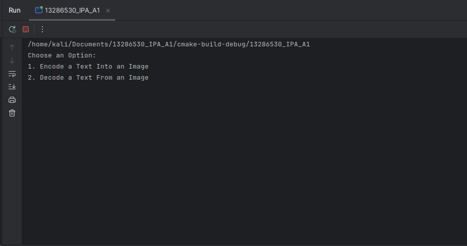

# 13286530_CW
---
Project Title: Encoding and Decoding a Message Hidden Inside an Image <br>
Author: Osama Rahmani <br>
Date: 29/03/2025 <br>
E-mail: rahmanio@coventry.ac.uk <br>
---
## Description:
### This project has been written  <br>
**The application for encoding the text message into a PNG image and also decoding the message from the image using the
Least Signification Bit (LSB) method with Caesar Cipher optional encryption.**<br><br>
**This application has been made as coursework for Programming and Operating systems module**

## Application Screenshot:

<br>
### Features
* **Text Encoding:** Hide secret messages in a .PNG images
* **Text Decoding:** Extract hidden messages from encoded images
* **Encryption:** Using Caesar Cipher encryption for more security(Uses 0 for no encryption)
* **Pixel Offset:** Configure starting pixel for encoding to improve security (Starts from 100)
* **Cross-Platform:** Works on windows and Linux

### Requirements
* **OpenCV 4.5 or later**
* **C++23 compatible compiler**


## File Structure:

├── **CMakeLists.txt** &emsp;&emsp;&emsp;&emsp;         # Build configuration <br>
├── **README.md** &emsp;&emsp;&emsp;&emsp;&emsp;              # This file <br>
├── **caesar_cipher.h** &emsp;&emsp;&emsp;&emsp;    # Caesar Cipher encryption/decryption <br>
├── **image_decoder.h** &emsp;&emsp;&emsp;&emsp;    # Image decoding functionality <br>
├── **image_encoder.h** &emsp;&emsp;&emsp;&emsp;    # Image encoding functionality <br>
├── **1 (6).jpg** &emsp;&emsp;&emsp;&emsp;&emsp;&emsp;&emsp;&emsp; # jpg image file <br>
├── **boat.png** &emsp;&emsp;&emsp;&emsp;&emsp;&emsp;&emsp;&emsp; # jpg image file <br>
├── **boat_encoded.png** &emsp;&emsp;&emsp; # jpg image file <br>

├── **TEST_CASES** <br>
│&emsp;├── **test_cases.cpp** &emsp;&emsp;&emsp;&emsp;  # Test cases implementation <br>
│&emsp;├── **CMakeLists.txt** &emsp;&emsp;&emsp;&emsp;  # Build configuration <br>


## Encoding and Decoding videos <br>
### Encode and Decoding a text into an image in Linux <br>
[Youtube video for Encoding and Decoding functionality (Linux)](https://www.youtube.com/watch?v=addbznxiO7U)<br>
### Encode and Decoding a text into an image in Windows <br>
[Youtube video for Decoding and Decoding functionality (Windows)](https://www.youtube.com/watch?v=a7K9OVJ7onU)<br>
### Test cases using GTEST <br>
[Youtube video for test cases](http://youtube.com/watch?v=99stAahhIEk)
<hr>

## Getting Started
### Dependencies
**Requirements and Libraries**: <br>
* OpenCV
* GTest


## Docstrings:
### main.cpp
```cpp
/**
*@file main.cpp
*@brief main program for encoding and decoding text into/from images using LSB steganography
*and Caesar Cipher encryption
*
*@usage : This program allows user to:
*1-encode a text into an image using the Least significant bit (LSB) method
*2-decode a text from an image that was previously encoded using the LSB method
*3-Optionally encrypt or decrypy the text with caesar cipher

*@headerfile caesar_cipher.h : for encrypting and decrypting the text using caesar cipher
*@headerfile image_encoder.h : for encoding the text into the image
*@headerfile image_decoder.h : for decoding the text from the image
*/

main_menu
/**
 *main_menu for the program
 * Variables
 * ---------
 * choice : integer
 * -the menu choice number 1 for encrypt and 2 for decrypt.
 * image_path : string
 * -The image path for encrypting
 * text : string
 * -the text to be encrypted into the image
 * output_path : string
 * -the path for saving the encrypted image + the suffix of _encoded
 * decoded_text : string
 * -the decoded string to be returned from decode_text_from_image function and to be shown to the user
 * @return saves the encoded image
*/
```
***
### caesar_cipher.h
```cpp
/**
*@file caesar_cipher.h
*@brief functions for encrypt and decrypy the text using Caesar Cipher method.
* This file contains two functions:
* - caesar_encrypt: encrypt the text using caesar cipher
* - caesar_decrypt: decrypt the text using caesar cipher
*
* Caesar Cipher is a substitution cipher that shifts each character by a fixed number in the alphabet order
*/

caesar_encrypt
/**
 *@brief This function shifts each alphabetic character in the input text by the value of shift value
 * @param text the text to encrypt
 * @param shift The number of shifting value for each character
 * @return The encrypted text
*/

caesar_decrypt
/**
 *@brief This function reverse the Caesar cipher encryption by shifting each character to the original position
 * @param text the text to decrypt
 * @param shift The number of positions to shift each character
 * @return the decrypt text
*/ 
```
***
### image_encoder.h
```cpp
/**
*@file image_encoder.h
*@brief functions for encoding text into an image using the LSB method
* This file contains the encode_text_into_image function, which encodes a given text into an image
* by modifying the LSB of each pixel's color channels
* the text can be encrypted if the shift value is provided and not zero
*/
/**
 * @brief Encoding the text into an image using the LSB method.
 * This function takes an input image, encodes the provided text into the image by modifying the LSB of each pixel's
 * color channels. and then saves the encoded image into a new file.
 * @param image_path path to the input image file which it must be only a png file
 * @param text the text to be encoded into the image
 * @param output_path path to save the encoded image file
 * @param pixel_offset the number of pixels to be escaped befor start encoding (100)
 * @param shiftvalue the shift value for caesar cipher encryption (0 for no encryption)
 * @return true if the encoding is successful, otherwise it returns false
 * variables
 * ----------
 * image_path : string
 * - The image path
 * text : string
 * - the text to be encrypted into the image
 * output_path : string
 * - the path for saving the encrypted image
 * pixel_offset : integer
 * - an integer number to determine the start point (pixel) for encryption
 * shiftvalue : int
 * - the number for shifting each character
 * processed_text : string
 * - the string for holding the result of calling the Caesar_encrypt (shifted text)
 * binary_text : string
 * - the variable to hold the strings of binary values of the processed (shifted) text for encryption
 * total_pixels : integer
 * - it used to calculate the size of the image in order to know if the image has enough pixel to be converted
 * @return saves the encoded image
*/
```

### image_decoder.h
```cpp
/**
*@file image_decoder.h
*@brief functions for decoding text into an image using the LSB method
*this file contains decode_text_from_image function, which extracts text from an image that was previously encoded
*using the LSB method.
*/
/**
 *@brief decodes the text from an image using the LSB method
 * @param image_path path to the encoded image file
 * @param pixel_offset the number of pixels to be skipped before starting the encoding (100)
 * @param shiftvalue the shift value for the caesar cipher decryption
 * @return decoded_text
 * variables
 *-----------
 *image_path : string
 * - The image path
 * pixel_offset : integer
 * - an integer number to determine the start point (pixel) for encryption
 * shiftvalue : int
 * - the number for shifting each character
 * binary_text : string
 * - the variable to hold the strings of binary values of the processed (shifted) text for encryption
 * end_symbol : string
 * - the symbol (%%%) as a delimiter to know where is the end of encoded string
 * bit : char
 * - the variable to hold the extracted LSB of the image
 * c : char
 * - converting the 8 bit to character in order to find the end symbol
 * last_3_byte : string
 * - the variable to find the delimiter %%%
*/
```
***
### Test cases
```cpp
#include <gtest/gtest.h>
#include "../caesar_cipher.h"
#include "../image_encoder.h"
#include <opencv2/opencv.hpp>
#include <filesystem>
#include "../image_decoder.h"

using namespace std;
using namespace cv;
    // CAESAR ENCODE DECODE TESTS
// testing if it encrypts and if the shift value works right
TEST(caesar_test, encrypt_text) {
    // Arrange
    string text = "Hello, World";
    int shift = 5;
    // Act
    string encrypted_text = caesar_encrypt(text, shift);
    // Assert
    EXPECT_EQ(encrypted_text, "Mjqqt, Btwqi");
}

// testing if it decrypts the text with shift provided
TEST(caesar_test, decrypt_text) {
    // Arrange
    string encrypted_text = "Mjqqt, Btwqi";
    int shift = 5;
    // Act
    string decrypted_text = caesar_decrypt(encrypted_text, shift);
    // Assert
    EXPECT_EQ(decrypted_text, "Hello, World");
}

// testing the encrypt result if no shift value provided
TEST(shift_test, encrypt_text) {
    // Arrange
    string text = "Hello, world" ;
    int shift = 0 ;
    // Act
    string no_encrypt = caesar_encrypt(text, shift) ;
    // Assert
    EXPECT_EQ(no_encrypt, "Hello, world");
}
// testing the large shift value
// the large shift value is passed in this test but its limited in the menu
//so the menu checks the shift value it accepts the shift between 0 and 20
TEST(caesar_test, L_shift) {
    string text = "Hello, World" ;
    int shift = 26;
    string encrypted_text = caesar_encrypt(text, shift);
    EXPECT_EQ(encrypted_text,text);
}
// testing for nonalphabetic characters
TEST(caesar_test,nonalphabetic) {
    string text = "123!@#";
    int shift = 5;
    EXPECT_EQ(caesar_encrypt(text,shift),"123!@#");
    EXPECT_EQ(caesar_encrypt("Hello, World!",3),"Khoor, Zruog!");
}
    // /CAESAR ENCODE DECODE TESTS
//-------------------------------------------------------------------------
    // ENCODING TESTS
// the function to create an image for testing
void create_test_image(const string& path) {
    Mat test_image(500,500,CV_8UC3, Scalar(255,255,255));
    imwrite("../" + path, test_image);
}
// the function to clean the test files
void cleanup_test_files() {
    if (filesystem::exists("../test.png")) {
        filesystem::remove("../test.png");
    }
    if (filesystem::exists("../test_encoded.png")) {
        filesystem::remove("../test_encoded.png");
    }
}
//------------------------------------------------------------------------
//encoding the basic message with no shift value
TEST(image_encoder_test, basic_encoding) {
    // Arrange
    const string input_image = "test.png";
    const string output_image = "test_encoded.png";
    create_test_image(input_image);

    // Act
    string message = "Hello World";
    bool result = encode_text_into_image(input_image, message, output_image);

    // Assert
    EXPECT_TRUE(result);
    EXPECT_TRUE(filesystem::exists("../" + output_image));

    // Cleanup
    cleanup_test_files();
}
// testing with the empty message
TEST(image_encoder_test, empty_message) {
    const string input_image = "test.png";
    const string output_image = "test_encoded.png";
    create_test_image(input_image);

    string message = "";
    bool result = encode_text_into_image(input_image, message, output_image);

    EXPECT_TRUE(result);

    cleanup_test_files();
}
//testing with the 1000 character long message
TEST(image_encoder_test, large_message) {
    const string input_image = "test.png";
    const string output_image = "test_encoded.png";
    create_test_image(input_image);

    string message(1000, 'x');  // 1000 character message
    bool result = encode_text_into_image(input_image, message, output_image);

    EXPECT_TRUE(result);

    cleanup_test_files();
}
// Test with non-existent file
TEST(image_encoder_test, invalid_image_path) {
    string message = "Test";
    bool result = encode_text_into_image("notexist.png", message, "test_encoded.png");

    EXPECT_FALSE(result);

    cleanup_test_files();
}

//-----------------------------------------------------------------------
// basic message decode
TEST(image_decode_test, basic_decoding) {
    create_test_image("test.png");
    encode_text_into_image("test.png", "Test message", "test_encoded.png");

    std::string decoded = decode_text_from_image("test_encoded.png");
    EXPECT_EQ(decoded, "Test message");

    cleanup_test_files();
}
// decoding a shifted message (5)
TEST(image_decode_test, shifted) {
    create_test_image("test.png");
    encode_text_into_image("test.png", "Hello", "test_encoded.png", 100, 5);

    std::string decoded = decode_text_from_image("test_encoded.png", 100, 5);
    EXPECT_EQ(decoded, "Hello");

    cleanup_test_files();
}
// Test with wrong image path
TEST(image_decode_test, wrong_image_path) {
    string decoded = decode_text_from_image("wrong_image.png");
    EXPECT_TRUE(decoded.empty());
}

TEST(image_decode_test, not_encoded_image) {
    // Setup
    create_test_image("test.png");

    // Test with image that has no encoded message
    string decoded = decode_text_from_image("test.png");
    EXPECT_FALSE(decoded.empty());
    // Cleanup
    cleanup_test_files();
}

//----------------------------------------------------------------

int main() {
    testing::InitGoogleTest();
    return RUN_ALL_TESTS();
}
```
### Test cases result
```cpp
/home/kali/Documents/13286530_IPA_A1/TEST_CASES/cmake-build-debug/13286530_IPA_A1
[ WARN:0@0.023] global loadsave.cpp:241 findDecoder imread_('../notexist.png'): can't open/read file: check file path/integrity
Could not open or find the image.
[ WARN:0@0.031] global loadsave.cpp:241 findDecoder imread_('../wrong_image.png'): can't open/read file: check file path/integrity
Could not open or load the image.
[==========] Running 13 tests from 4 test suites.
[----------] Global test environment set-up.
[----------] 4 tests from caesar_test
[ RUN      ] caesar_test.encrypt_text
[       OK ] caesar_test.encrypt_text (0 ms)
[ RUN      ] caesar_test.decrypt_text
[       OK ] caesar_test.decrypt_text (0 ms)
[ RUN      ] caesar_test.L_shift
[       OK ] caesar_test.L_shift (0 ms)
[ RUN      ] caesar_test.nonalphabetic
[       OK ] caesar_test.nonalphabetic (0 ms)
[----------] 4 tests from caesar_test (0 ms total)

[----------] 1 test from shift_test
[ RUN      ] shift_test.encrypt_text
[       OK ] shift_test.encrypt_text (0 ms)
[----------] 1 test from shift_test (0 ms total)

[----------] 4 tests from image_encoder_test
[ RUN      ] image_encoder_test.basic_encoding
output_path -> test_encoded.png
Image encoded successfully into: test_encoded.png
[       OK ] image_encoder_test.basic_encoding (7 ms)
[ RUN      ] image_encoder_test.empty_message
output_path -> test_encoded.png
Image encoded successfully into: test_encoded.png
[       OK ] image_encoder_test.empty_message (3 ms)
[ RUN      ] image_encoder_test.large_message
output_path -> test_encoded.png
Image encoded successfully into: test_encoded.png
[       OK ] image_encoder_test.large_message (3 ms)
[ RUN      ] image_encoder_test.invalid_image_path
[       OK ] image_encoder_test.invalid_image_path (0 ms)
[----------] 4 tests from image_encoder_test (14 ms total)

[----------] 4 tests from image_decode_test
[ RUN      ] image_decode_test.basic_decoding
output_path -> test_encoded.png
Image encoded successfully into: test_encoded.png
converting binary_text to string
[       OK ] image_decode_test.basic_decoding (4 ms)
[ RUN      ] image_decode_test.shifted
output_path -> test_encoded.png
Image encoded successfully into: test_encoded.png
converting binary_text to string
[       OK ] image_decode_test.shifted (3 ms)
[ RUN      ] image_decode_test.wrong_image_path
[       OK ] image_decode_test.wrong_image_path (0 ms)
[ RUN      ] image_decode_test.not_encoded_image
converting binary_text to string
[       OK ] image_decode_test.not_encoded_image (36 ms)
[----------] 4 tests from image_decode_test (44 ms total)

[----------] Global test environment tear-down
[==========] 13 tests from 4 test suites ran. (59 ms total)
[  PASSED  ] 13 tests.

Process finished with exit code 0
```